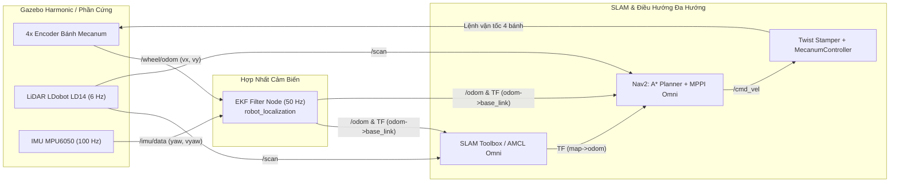

# 🤖 Mecanum Autonomous Mobile Robot — ROS 2 Jazzy & Gazebo Harmonic

[](https://docs.ros.org/en/jazzy/)
[-orange.svg)](https://gazebosim.org/)
[](https://opensource.org/licenses/Apache-2.0)

Dự án mô phỏng toàn diện (**Digital Twin**), hợp nhất cảm biến (**EKF Sensor Fusion**), lập bản đồ (**Pose-Graph SLAM**) và điều hướng tự hành đa hướng (**Holonomic Navigation - Nav2 MPPI**) cho robot 4 bánh Mecanum trang bị **LiDAR 2D LDobot LD14** và **IMU 6 trục MPU6050**.

---

## ✨ Tính năng nổi bật

* **Vật lý Mecanum chuẩn xác trên Gazebo Harmonic:** Sử dụng mô hình va chạm điểm kết hợp ma sát dị hướng Coulomb–DART (`fdir1` góc $\pm 45^\circ$) giúp xe di chuyển đa hướng (tiến, lùi, trượt ngang, đi chéo, xoay tại chỗ) mượt mà.
* **Bản sao số (Digital Twin) cảm biến thực tế:**
  * **LiDAR LDobot LD14:** Tần số quét `6 Hz`, `383 mẫu/vòng` 360°, tầm đo `0.15m – 8.0m`, tích hợp nhiễu Gaussian `±1 cm`.
  * **IMU 6 trục MPU6050 (GY-521):** Tần số `100 Hz` (`/imu/data`), mô phỏng nhiễu nhiệt và độ trôi thiên lệch (bias drift) thực tế của con quay hồi chuyển và gia tốc kế.
* **Hợp nhất cảm biến EKF (`robot_localization`):** Kết hợp vận tốc dài $(v_x, v_y)$ từ Encoder 4 bánh (`/wheel/odom`) với góc hướng và vận tốc góc $(\psi, \dot{\psi})$ từ MPU6050 (`/imu/data`) ở tần số `50 Hz`, triệt tiêu sai số trượt con lăn Mecanum.
* **SLAM & Điều hướng đa hướng (Holonomic Nav2):**
  * **SLAM Toolbox (`online_async`):** Tối ưu đồ thị tư thế bằng Google Ceres Solver (`SPARSE_NORMAL_CHOLESKY`).
  * **AMCL (`OmniMotionModel`):** Định vị hạt thích nghi đa hướng 3 bậc tự do.
  * **MPPI Controller (`Omni`):** Dự báo song song `2000` quỹ đạo đa hướng trên chân trời `2.8s` kết hợp `TwirlingCritic` và `PathAngleCritic (mode: 2)` giúp xe lách ngang qua hành lang hẹp.

---

## 🏗️ Kiến trúc Hệ thống



---

## 📐 Thông số Kỹ thuật Robot

| Thành phần | Thông số | Giá trị trong mô hình |
| :--- | :--- | :--- |
| **Khung xe (`chassis`)** | Kích thước $(D \times R \times C)$ / Khối lượng | `0.30 × 0.24 × 0.11 m` / `4.4 kg` |
| **Bánh xe Mecanum (×4)** | Bán kính $r$ / Độ dày / Khối lượng | `0.0485 m` / `0.048 m` / `0.15 kg` |
| **Khoảng cách đặt bánh** | $L_x$ (trước-sau) / $L_y$ (trái-phải) / $L_x + L_y$ | `0.125 m` / `0.150 m` / `0.275 m` |
| **Giới hạn động học** | $v_{x,\max}, v_{y,\max}$ / $\omega_{z,\max}$ | `±0.5 m/s` / `±1.0 rad/s` |
| **LiDAR LDobot LD14** | Tốc độ quét / Số tia / Tầm đo | `6 Hz` / `383 mẫu` / `0.15 – 8.0 m` |
| **IMU MPU6050** | Tần số / Nhiễu Gyro / Nhiễu Accel | `100 Hz` / `0.00087 rad/s` / `0.039 m/s²` |

---

## 📂 Cấu trúc Thư mục

```text
mecanum_sim_ws/
├── BAO_CAO_QUY_TRINH_VA_THUAT_TOAN_MECANUM.txt   # Tài liệu thuyết minh quy trình & thuật toán
└── src/
    └── mecanum_description/
        ├── config/
        │   ├── controllers.yaml                  # Cấu hình MecanumDriveController (50 Hz)
        │   ├── ekf.yaml                          # Cấu hình bộ lọc EKF (Encoder + MPU6050)
        │   ├── gz_bridge.yaml                    # Cầu nối Gazebo <-> ROS 2 (/clock, /scan, /imu/data)
        │   ├── nav2_params.yaml                  # Cấu hình Nav2 đa hướng (AMCL Omni + MPPI Omni)
        │   └── slam_params.yaml                  # Cấu hình SLAM Toolbox (Ceres Solver)
        ├── launch/
        │   ├── display.launch.py                 # Xem và kiểm tra mô hình URDF trên RViz2
        │   ├── gazebo.launch.py                  # Khởi chạy Gazebo, ros2_control, EKF & twist_stamper
        │   ├── slam.launch.py                    # Khởi chạy SLAM Toolbox lập bản đồ
        │   └── navigation.launch.py              # Khởi chạy tự hành Nav2 trên bản đồ có sẵn
        ├── maps/
        │   ├── my_gazebo_map.pgm                 # Bản đồ Occupancy Grid đã quét
        │   └── my_gazebo_map.yaml                # Metadata bản đồ (0.05 m/pixel)
        ├── rviz/
        │   ├── display.rviz                      # Giao diện RViz kiểm tra URDF
        │   ├── sim.rviz                          # Giao diện RViz cho Gazebo độc lập
        │   └── mecanum.rviz                      # Giao diện RViz cho SLAM & Nav2
        ├── urdf/
        │   ├── robot_core.xacro                  # Khung xe, 4 bánh Mecanum & ma sát dị hướng fdir1
        │   ├── ros2_control.xacro                # Giao diện phần cứng GazeboSimSystem
        │   ├── lidar.xacro                       # Mô hình & plugin cảm biến LDobot LD14
        │   └── imu.xacro                         # Mô hình & plugin cảm biến IMU MPU6050
        └── worlds/
            └── obstacles.sdf                     # Phòng thử nghiệm 10m x 10m có vật cản & hành lang hẹp
```

---

## ⚙️ Cài đặt & Biên dịch (ROS 2 Jazzy)

### 1. Cài đặt các gói phụ thuộc
```bash
sudo apt update && sudo apt install -y \
  ros-jazzy-ros-gz \
  ros-jazzy-gz-ros2-control \
  ros-jazzy-ros2-control \
  ros-jazzy-ros2-controllers \
  ros-jazzy-mecanum-drive-controller \
  ros-jazzy-robot-localization \
  ros-jazzy-slam-toolbox \
  ros-jazzy-navigation2 \
  ros-jazzy-nav2-bringup \
  ros-jazzy-twist-stamper \
  ros-jazzy-joint-state-publisher-gui \
  ros-jazzy-teleop-twist-keyboard \
  ros-jazzy-xacro
```

### 2. Clone và Build Workspace
```bash
git clone https://github.com/htkt28/mecanum_sim_ros2.git ~/mecanum_sim_ws
cd ~/mecanum_sim_ws
source /opt/ros/jazzy/setup.bash
colcon build --packages-select mecanum_description
source install/setup.bash
```

---

## 🚀 Hướng dẫn Chạy Mô phỏng

> **Lưu ý:** Không chạy `display.launch.py` cùng lúc với `gazebo.launch.py` để tránh xung đột đồng hồ `use_sim_time`.

### 1. Chạy Tự hành Đa hướng với Nav2 (Sử dụng bản đồ có sẵn)
* **Terminal 1 — Bật môi trường Gazebo, Controller & Bộ lọc EKF:**
  ```bash
  source /opt/ros/jazzy/setup.bash
  source ~/mecanum_sim_ws/install/setup.bash
  ros2 launch mecanum_description gazebo.launch.py
  ```
* **Terminal 2 — Bật Nav2 & RViz2:**
  ```bash
  source /opt/ros/jazzy/setup.bash
  source ~/mecanum_sim_ws/install/setup.bash
  ros2 launch mecanum_description navigation.launch.py
  ```
  *Trên RViz2: dùng công cụ **2D Goal Pose** chấm và kéo hướng đích trên bản đồ để xe tự động lập quỹ đạo và di chuyển đa hướng.*

---

### 2. Quét Bản đồ Mới với SLAM Toolbox
* **Terminal 1 — Bật Gazebo:**
  ```bash
  ros2 launch mecanum_description gazebo.launch.py
  ```
* **Terminal 2 — Bật SLAM Toolbox & RViz2:**
  ```bash
  ros2 launch mecanum_description slam.launch.py
  ```
* **Terminal 3 — Điều khiển xe bằng bàn phím (hỗ trợ trượt ngang khi giữ `Shift` + `J/L/U/O`):**
  ```bash
  ros2 run teleop_twist_keyboard teleop_twist_keyboard
  ```
* **Lưu bản đồ sau khi quét xong:**
  ```bash
  ros2 run nav2_map_server map_saver_cli -f ~/mecanum_sim_ws/src/mecanum_description/maps/my_gazebo_map
  cd ~/mecanum_sim_ws && colcon build --packages-select mecanum_description
  ```

---

### 3. Chỉ kiểm tra Mô hình 3D URDF trên RViz2
```bash
ros2 launch mecanum_description display.launch.py
```

---

## 📖 Tài liệu Thuật toán Chi tiết
Xem chi tiết cơ sở toán học của 8 thuật toán cốt lõi trong dự án tại file **[`BAO_CAO_QUY_TRINH_VA_THUAT_TOAN_MECANUM.txt`](./BAO_CAO_QUY_TRINH_VA_THUAT_TOAN_MECANUM.txt)**.
