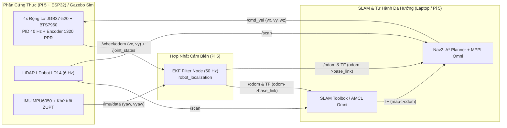

# 🤖 Mecanum Autonomous Mobile Robot — ROS 2 Jazzy (Gazebo Harmonic & Real Hardware)

[](https://docs.ros.org/en/jazzy/)
[-orange.svg)](https://gazebosim.org/)
[](https://www.raspberrypi.com/)
[](https://opensource.org/licenses/Apache-2.0)

Dự án hoàn chỉnh từ **Mô phỏng Bản sao số (Digital Twin trên Gazebo Harmonic)** đến **Triển khai Thực tế ngoài đời thực** cho Robot tự hành đa hướng 4 bánh Mecanum kết cấu 2 tầng, sử dụng **Raspberry Pi 5**, **ESP32 (4× BTS7960 + 4× Encoder JGB37-520)**, **LiDAR 2D LDobot LD14** và **IMU 6 trục MPU6050**.

---

## ✨ Tính năng nổi bật

* **Triển khai song song Mô phỏng & Phần cứng thực (`Sim-to-Real 100%`):** Dùng chung một mô hình URDF 2 tầng, cùng cấu hình hợp nhất cảm biến EKF, SLAM Toolbox và bộ điều khiển tự hành đa hướng Nav2 MPPI.
* **Firmware Thời gian thực trên ESP32 (`40 Hz`):**
  * Đọc xung 4 kênh Encoder Full-Quadrature bằng bộ đếm phần cứng `PCNT` (`1320 xung/vòng`).
  * Điều khiển vòng kín 4 bộ **PID vận tốc độc lập** xuất băm xung kép `20 kHz` qua 4 mạch cầu H **BTS7960** kèm cơ chế phanh an toàn **Watchdog `500 ms`**.
* **Thuật toán ZUPT (*Zero-Velocity Update*) khử trôi Gyro thời gian thực:** Tự động học và triệt tiêu độ trôi điểm 0 của con quay hồi chuyển **MPU6050** mỗi khi 4 bánh xe đứng yên, giữ góc hướng ổn định tuyệt đối `0.0000 rad/s`.
* **Tự động nhận diện cổng USB (`Auto-USB Detection`):** Tự động phân biệt gói dữ liệu của **LiDAR LD14** và **ESP32** trên các cổng `/dev/ttyUSB*` mà không phụ thuộc thứ tự cắm dây.
* **SLAM & Điều hướng đa hướng (Holonomic Nav2):**
  * **SLAM Toolbox (`online_async`):** Tối ưu đồ thị tư thế bằng Google Ceres Solver (`SPARSE_NORMAL_CHOLESKY`).
  * **AMCL (`OmniMotionModel`) & MPPI (`Omni`):** Dự báo song song `2000` quỹ đạo đa hướng giúp xe tiến, lùi, xoay và trượt ngang tránh vật cản mượt mà.

---

## 🏗️ Kiến trúc Hệ thống



---

## 📐 Thông số Cơ khí & Sơ đồ Chân ESP32

### 1. Kích thước Khung xe 2 tầng (`robot_core.xacro`)
| Thành phần | Thông số | Giá trị |
| :--- | :--- | :--- |
| **Tầng 1 (Đế dưới)** | Dài × Rộng × Dày / Khoảng sáng tới tâm bánh | `30 × 24 × 2 cm` / `+3.0 cm` |
| **Tầng 2 (Đế trên)** | Dài × Rộng × Dày / Độ cao từ Tầng 1 | `20 × 24 × 1 cm` (sát đuôi xe) / `+8.0 cm` |
| **Bánh xe Mecanum (×4)** | Bán kính $r$ / Đường kính / $L_x + L_y$ | `0.0485 m` / `97 mm` / `0.125 + 0.150 = 0.275 m` |
| **Động cơ & Encoder** | JGB37-520 (`1:30`, `11 PPR`) | `1320 xung/vòng` (Full-Quadrature 4x) |
| **LiDAR LDobot LD14** | Tốc độ quét / Số tia / Tầm đo | `6 Hz` / `383 mẫu` / `0.15 – 8.0 m` |

### 2. Sơ đồ nối chân ESP32 (`esp32_mecanum_firmware/src/main.cpp`)
| Cụm thiết bị | Ký hiệu | Chân GPIO trên ESP32 |
| :--- | :---: | :--- |
| **Bánh 1 — Trái Trước (`IDX_FL`)** | `idx 0` | Encoder `(A=32, B=33)` · BTS7960 `(RPWM=2, LPWM=15)` |
| **Bánh 2 — Phải Trước (`IDX_FR`)** | `idx 1` | Encoder `(A=26, B=25)` · BTS7960 `(RPWM=13, LPWM=14)` |
| **Bánh 3 — Phải Sau (`IDX_RR`)** | `idx 2` | Encoder `(A=16, B=17)` · BTS7960 `(RPWM=22, LPWM=23)` |
| **Bánh 4 — Trái Sau (`IDX_RL`)** | `idx 3` | Encoder `(A=19, B=18)` · BTS7960 `(RPWM=4, LPWM=5)` |
| **Cảm biến IMU MPU6050 (I2C)** | `Wire` | `SDA = GPIO 21` · `SCL = GPIO 27` (`400 kHz`) |

---

## 📂 Cấu trúc Thư mục

```text
mecanum_sim_ws/
├── BAO_CAO_QUY_TRINH_VA_THUAT_TOAN_MECANUM.txt   # Thuyết minh chi tiết quy trình & thuật toán
├── esp32_mecanum_firmware/                       # Firmware PlatformIO nạp cho vi điều khiển ESP32
│   ├── platformio.ini                            # Cấu hình board esp32dev & thư viện phụ thuộc
│   └── src/main.cpp                              # Code PID 4 bánh, Động học Mecanum, đọc Encoder & MPU6050
└── src/
    └── mecanum_description/
        ├── config/                               # controllers.yaml, ekf.yaml, slam_params.yaml, nav2_params.yaml
        ├── launch/
        │   ├── real_robot.launch.py              # Khởi chạy Phần cứng thật trên Raspberry Pi 5 (Auto-USB)
        │   ├── gazebo.launch.py                  # Khởi chạy Mô phỏng Gazebo Harmonic trên Laptop
        │   ├── slam.launch.py                    # Khởi chạy SLAM Toolbox lập bản đồ (Sim & Real)
        │   ├── navigation.launch.py              # Khởi chạy tự hành Nav2 đa hướng (Sim & Real)
        │   └── display.launch.py                 # Kiểm tra mô hình 3D URDF trên RViz2
        ├── scripts/
        │   └── esp32_bridge.py                   # Node cầu nối USB-Serial Pi 5 <-> ESP32 tích hợp khử trôi ZUPT
        ├── maps/                                 # Bản đồ phòng mô phỏng (my_gazebo_map) & phòng thật (my_real_room)
        ├── rviz/                                 # Cấu hình giao diện hiển thị RViz2
        ├── urdf/                                 # robot_core.xacro (2 tầng), lidar.xacro, imu.xacro, ros2_control.xacro
        └── worlds/obstacles.sdf                  # Môi trường mô phỏng 10m x 10m
```

---

## 🚗 Hướng dẫn Vận hành Robot Thực tế (Raspberry Pi 5 + ESP32 + LD14)

### Bước 1: Khởi chạy Phần cứng trên Raspberry Pi 5
Đăng nhập SSH vào Raspberry Pi 5 (cắm sẵn LiDAR LD14 & ESP32, bật công tắc động cơ 12V sau khi ESP32 khởi động 3 giây):
```bash
ssh raspberrypi5@192.168.1.8
source ~/.bashrc
sudo chmod 666 /dev/ttyUSB* /dev/ttyACM* 2>/dev/null
ros2 launch mecanum_description real_robot.launch.py
```

### Bước 2: Quét & Lưu Bản đồ Phòng thật (Trên Laptop)
* **Terminal 1 (SLAM + RViz2):**
  ```bash
  source ~/mecanum_sim_ws/install/setup.bash
  export ROS_DOMAIN_ID=10
  export ROS_AUTOMATIC_DISCOVERY_RANGE=SUBNET
  export ROS_STATIC_PEERS=192.168.1.8
  ros2 launch mecanum_description slam.launch.py use_sim_time:=false
  ```
* **Terminal 2 (Lái xe bằng bàn phím ở tốc độ êm `0.25 m/s`):**
  ```bash
  source /opt/ros/jazzy/setup.bash
  export ROS_DOMAIN_ID=10
  export ROS_AUTOMATIC_DISCOVERY_RANGE=SUBNET
  export ROS_STATIC_PEERS=192.168.1.8
  ros2 run teleop_twist_keyboard teleop_twist_keyboard --ros-args -p speed:=0.25 -p turn:=0.6
  ```
* **Lưu bản đồ (chạy khi `slam.launch.py` vẫn đang mở):**
  ```bash
  ros2 run nav2_map_server map_saver_cli \
    -f ~/mecanum_sim_ws/src/mecanum_description/maps/my_real_room \
    --ros-args -p save_map_timeout:=10.0
  ```

### Bước 3: Chạy Tự hành Đa hướng Ngoài thực tế (Nav2 MPPI Omni)
Tắt `slam.launch.py` và `teleop_twist_keyboard`, giữ nguyên `real_robot.launch.py` trên Pi 5, sau đó chạy trên Laptop:
```bash
source ~/mecanum_sim_ws/install/setup.bash
export ROS_DOMAIN_ID=10
export ROS_AUTOMATIC_DISCOVERY_RANGE=SUBNET
export ROS_STATIC_PEERS=192.168.1.8
ros2 launch mecanum_description navigation.launch.py \
  use_sim_time:=false \
  map:=$HOME/mecanum_sim_ws/src/mecanum_description/maps/my_real_room.yaml
```
*Trên RViz2: dùng **2D Pose Estimate** căn chỉnh vị trí ban đầu của xe trùng khớp tường, sau đó dùng **2D Goal Pose** chọn điểm đích để xe tự hành.*

### Bước 4: Tắt Raspberry Pi 5 An toàn
Nhấn `Ctrl + C` dừng các node, sau đó gõ `sudo poweroff` trên SSH của Pi 5 và đợi đèn LED chuyển sang **màu Đỏ đứng im** trước khi ngắt nguồn.

---

## 🖥️ Hướng dẫn Chạy Mô phỏng (Gazebo Harmonic)

* **Terminal 1 — Bật môi trường Gazebo, Controller & Bộ lọc EKF:**
  ```bash
  source ~/mecanum_sim_ws/install/setup.bash
  ros2 launch mecanum_description gazebo.launch.py
  ```
* **Terminal 2 — Bật Tự hành Nav2 (hoặc `slam.launch.py`):**
  ```bash
  source ~/mecanum_sim_ws/install/setup.bash
  ros2 launch mecanum_description navigation.launch.py
  ```

---

## 📖 Tài liệu Thuật toán Chi tiết
Xem đầy đủ cơ sở toán học của các thuật toán điều khiển, hợp nhất cảm biến và triển khai phần cứng tại **[`BAO_CAO_QUY_TRINH_VA_THUAT_TOAN_MECANUM.txt`](./BAO_CAO_QUY_TRINH_VA_THUAT_TOAN_MECANUM.txt)**.
